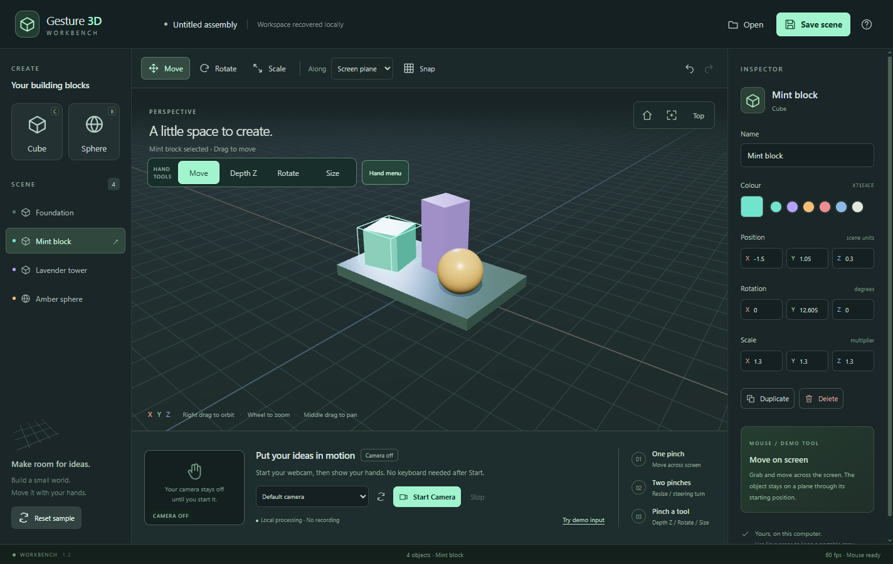

# Gesture 3D Workbench

By Ross Bannerman · [Rossi](https://rossi-software.com/work/3d-hand-workbench/)

[Download for Windows (ZIP)](https://github.com/RossBanner/gesture-3d-workbench/releases/download/v1.2.0/gesture-3d-workbench-1.2.0-windows-x64.zip) · [Release notes](https://github.com/RossBanner/gesture-3d-workbench/releases/tag/v1.2.0)

Free Windows 10/11 x64 desktop prototype. No account or payment required. The download is an unsigned portable app: extract the whole ZIP, keep the application folder together, and run **Gesture 3D Workbench.exe** inside it. Windows may display an unknown-publisher or reputation warning. Only download from this repository and review the supplied SHA-256 checksum; do not disable security protection. macOS and Linux packages are not provided.



A local Windows 3D assembly workbench using your webcam. Processing, rendering and scene storage run on your computer. No account, cloud service or extra hardware is required.

## Open the app

For the ready-to-run app, use the download above. Extract all files, open **Gesture 3D Workbench-win32-x64** and run **Gesture 3D Workbench.exe**. No Node.js installation is needed for this download. Keep the entire folder together.

Click **Start Camera** once. Show an open hand, then pinch thumb and index. All four buttons in the **HAND TOOLS** bar can be selected with either hand: point at a button, pinch, open, then pinch a shape.

## Controls

| Hand tool | Gesture | Result |
|---|---|---|
| **Move** | Pinch a shape and move | Move across the screen plane |
| **Move** | Add a second pinch, then spread/squeeze | Enlarge/shrink uniformly |
| **Move** | Turn the line between two pinches like a steering wheel | Roll the object |
| **Depth Z** | Pinch a shape, then slide down/up | Increase/decrease scene Z; X/Y, rotation and scale stay fixed |
| **Rotate** | Pinch a shape; move sideways or up/down | Turn or tilt; position and scale stay fixed |
| **Rotate** | Keep first pinch and add a second; move second pinch relative to first | Turn/tilt using the second hand |
| **Size** | Pinch and move up/down, or use two pinches and spread/squeeze | Resize with position and rotation held fixed |
| **Move**, optional shortcut | Keep first pinch and close the other hand into a fist | Lock Depth Z; slide the grabbing hand up/down |
| Fist shortcut | Deliberately open the helper palm for about a quarter second | Unlock depth and return to Move |
| Any tool | Open the grabbing fingers | Place the shape |
| During a grab | Use the other hand to pinch **Cancel grab** | Roll back that whole grab |

In **Rotate**, palm tilting is no longer required. Move your pinched fingertips sideways to turn, or up/down to tilt. In Move, two-hand steering rotation remains available; use Rotate for controlled yaw/pitch.

**Depth Z is real scene translation, not a scale operation.** A blue Z guide and wireframe starting position make it visible, and the badge shows the actual Z coordinate. Down increases Z and up decreases Z. At the home view, positive Z comes toward the front of the stage; after orbiting, it still follows the scene's Z axis. Perspective can change apparent screen size as an object moves through depth, but its Scale values remain unchanged.

The optional fist is recognized from curled fingers, including a tucked thumb touching the index. Once recognized, it stays locked through uncertain estimates until you deliberately show an open palm. A brief tracking dropout freezes movement and rebases on return, preserving the grab for up to 600 ms. Longer loss or crossed/ambiguous hands places the last stable result and requires opening before another grab. Missing frames cannot complete a new pinch.

## Estimated push/pull

The palm-size depth estimate is **off by default**. You can enable it using **Hand menu → Estimated push/pull**, for a single pinch in Move. It estimates movement from changes in apparent palm size and pauses during palm turns. It cannot measure physical camera distance. For deliberate depth control, use Depth Z.

## Hands-only menus and views

Pinch **Hand menu** for add, duplicate, colour, undo/redo, delete confirmation, snap, home/focus/top view, camera stop and local scene storage. Open your fingers between commands.

**Keep scene** stores an automatically named local copy; **Saved scenes** restores it. Six slots are available and a full shelf never silently overwrites a copy. The scene recovery copy and shelf are stored locally. For portable `.g3d.json` files, use Save scene / Open and the Windows file dialogs.

Pinch empty space to orbit the view. Add a second pinch and spread/squeeze to zoom. The camera preview guide marks the central area that maps to the full workspace, making edge buttons reachable with visible fingers.

## Mouse fallback

The top mouse toolbar retains Move/Rotate/Scale and Screen/Floor/X/Y/Z constraints. Right-drag orbits, middle-drag pans, wheel zooms. Inspector values remain editable.

G/R/S selects mouse mode; X/Y/Z selects an axis; N toggles snap; F focuses; H resets view; C/B adds shapes; Delete removes; Ctrl+D duplicates; Ctrl+Z/Y undoes/redoes; Ctrl+S/O saves/opens; Escape cancels a grab.

## Tracking and privacy

- Camera acquisition remains an explicit Start Camera action. No webcam video is recorded or transmitted.
- Stopping, minimizing or closing the app releases the camera. Editing pauses while unfocused or in a dialog.
- Stable palm position associates hands independently of detector order and handedness labels.
- Tracking runs in a local CPU worker. The bundled GPU delegate missed one hand in the earlier recorded two-hand check on this device; 3D rendering still uses GPU.
- Clear lighting and visible, separated hands help tracking. Physical occlusion can still prevent the model from finding a hand.
- The app is a creative workbench, not precision CAD or measured room-depth tracking.

## Development

Node.js 22.12+ is required; dependencies are pinned and model/WASM assets are bundled.

```powershell
npm ci
npm start
npm test
npm run build
npm run package
npm run test:desktop
npm run test:hands
```

Install/build tools can require network access; the delivered app runs offline. The app uses a secure local protocol with no listening server. The optional development server binds to 127.0.0.1.

`src/hand-tracking.ts` measures curl and pinch, latches the fist, associates hands and holds short dropouts. `src/hands-controller.ts` manages hand tools and gestures. `src/hand-transform.ts` separates depth, rotation and scaling. `src/workspace.ts` draws the depth/rotation guides.

## Validation boundary

60 unit tests pass. Packaged checks cover the actual local model on blank, two-hand and closed-fist images, plus scene editing, file persistence and errors. The gesture regression run covers synthetic noisy sequences and official recorded fist landmark replay through the production controller.

**A live physical session with the new controls has not been verified by a human.** Recorded images and replayed landmarks do not establish live tracking accuracy. The user-reported failures in 1.1 motivated these changes; earlier synthetic success did not establish usability. The old 1.0 webcam acquisition report is historical only.

See `docs/HANDS_GUIDE.md` for quick controls and `docs/TEST_RESULTS.md` for results and limits.
